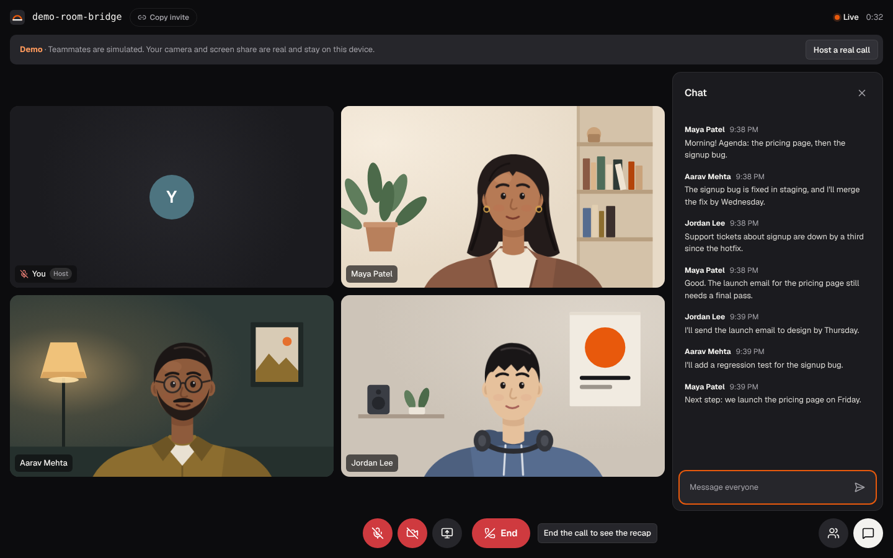
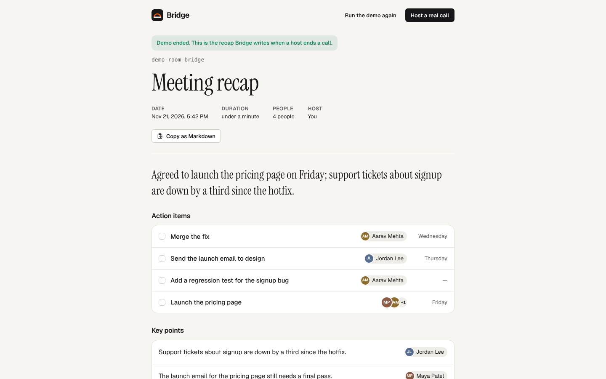

# Bridge

**Video calls for small teams that end with a written recap.** Start a room in one click, share the link, talk. When the host ends the call, everyone gets the summary, the action items with owners and due days, and the transcript.

**[Try the live demo →](https://bridgefrontend.onrender.com/demo)** No account needed. Join a call with a simulated team, add a line to the chat, end it, and read the recap Bridge writes.


| In the call | The recap it produces |
| --- | --- |
|  |  |

- **App:** [bridgefrontend.onrender.com](https://bridgefrontend.onrender.com)
- **Engineering write-up:** [docs/CASE_STUDY.md](docs/CASE_STUDY.md) · [ARCHITECTURE.md](ARCHITECTURE.md) · [DESIGN.md](DESIGN.md)

> [!NOTE]
> The API runs on a free instance that sleeps when idle; a cold start takes about 20 seconds. The landing page wakes it in the background and the sign-in form shows a "waking the server" status instead of a blank wait. The demo runs entirely in the browser and never waits.

## What it does

- **Rooms from a link.** One click makes a room with a code like `kmt-vrqp-xhw`. A lobby checks the camera and microphone before anyone sees you.
- **Peer-to-peer video.** WebRTC mesh: audio and video go directly between participants, never through the server. Camera, microphone and screen share, with automatic reconnection when the network drops.
- **Live room state.** Socket.IO syncs joins, leaves, chat, removals and the end of the call. Reconnects never create duplicate participants.
- **Host controls, enforced on the server.** Only the host can remove someone or end the call. The API returns `403` for anyone else; the UI hiding the button is not the protection.
- **The recap.** When the host ends the call, the server turns the chat and activity log into a summary sentence, action items (owner and due day), key points and topics. It is stored with the meeting and opens from everyone's history. It can be copied as Markdown for Slack, Notion or email.
- **Secure sessions.** Short-lived JWT access tokens, rotating refresh tokens in an HTTP-only cookie, CSRF protection on refresh and logout, per-device sessions and "log out everywhere".

### The recap is deterministic, not AI

The summariser (`backend/src/utils/meetingSummary.js`) is rule-based: commitments such as "I'll…" or "Aarav owns…" become action items, weekday and "today" phrases become due days, and recurring noun phrases become topics. No external AI service is called, and the same chat always produces the same recap. The public demo runs a browser copy of the same file, and a parity test fails the build if the two ever disagree.

## How it's built

| Layer | Choices |
| --- | --- |
| Frontend | React 18, TypeScript, Vite, React Router, CSS Modules, Motion |
| Backend | Node.js, Express, Zod validation, centralised error handling, rate limiting, Helmet |
| Data | MongoDB with Mongoose (users, sessions, meetings, activity logs, recaps) |
| Real time | Socket.IO rooms scoped by meeting, authenticated with the access token; WebRTC mesh for media |
| Testing | Node test runner (unit and integration), Vitest, Playwright end to end, axe accessibility checks |

```text
backend/src/
  controllers/  routes/  services/  models/  validators/  middlewares/  utils/
frontend/src/
  pages/        one file per route
  features/     room (WebRTC + sockets), meetings, demo, landing
  auth/  components/  lib/  styles/
frontend/tests/e2e/
```

See [ARCHITECTURE.md](ARCHITECTURE.md) for the request, socket and token flows.

## Testing

```bash
cd backend && npm test          # unit + integration (integration uses an in-memory MongoDB)
cd frontend && npm test         # unit tests (Vitest)
cd frontend && npm run test:e2e # Playwright: starts both servers itself
```

The Playwright suite covers:

- Register, sign in, and stay signed in after a reload
- Create a meeting and join it from an invite link
- Real-time chat, mute, and leave and rejoin
- Host-only removal: a participant has no remove control and the API returns `403`
- Ending the meeting, the redirect to the recap, and both people opening it from history
- Unauthorised recap access returning `403`
- The public demo ending in a recap built by the same rules as the server
- The room grid reflowing when the window narrows
- Axe WCAG 2.1 AA checks on the landing, auth, demo and not-found pages

Every product claim on the landing page names the source file that makes it true, and a unit test (`frontend/src/features/landing/content.test.ts`) fails the build if one stops matching.

<details>
<summary>Notes for running the E2E suite</summary>

Playwright starts the backend on port `8100` and the frontend on port `3100`. `backend/.env` must be populated (`MONGODB_URI` and the JWT secrets); run `cd backend && npm run db:memory` for a throwaway database. On Linux the browser needs its system libraries once: `sudo npx playwright install-deps chromium`.

The suite creates real users and meetings in whatever database `MONGODB_URI` points at, and each run uses 3 of the 10 sign-in attempts the auth rate limiter allows per IP per 15 minutes.

</details>

## Run it locally

Requires Node.js 22 (pinned in `.node-version`) and a MongoDB connection string.

```bash
# API on http://localhost:8000
cd backend
cp .env.example .env    # set MONGODB_URI, JWT_SECRET and JWT_REFRESH_SECRET
npm install
npm run dev

# Web app on http://localhost:3000
cd frontend
cp .env.example .env    # VITE_BACKEND_URL=http://localhost:8000
npm install
npm run dev
```

## API

| Area | Routes |
| --- | --- |
| Auth | `POST /api/v1/users/register` · `login` · `refresh` · `logout` · `logout-all` · `GET /api/v1/users/me` |
| Meetings | `POST /api/v1/meetings` · `GET /api/v1/meetings` · `GET /api/v1/meetings/:meetingId` |
| Lifecycle | `POST /api/v1/meetings/:meetingId/join` · `leave` · `end` · `remove-participant` · `PATCH …/settings` |
| Recap | `GET /api/v1/meetings/:meetingId/summary` |
| Health | `GET /api/v1/health` |

## Limits and trade-offs

- **Call size.** A mesh sends every stream to every peer, so calls work best with up to about six people. An SFU (for example LiveKit or mediasoup) is the next step past that.
- **Restrictive networks.** Only STUN is configured by default. Peers behind symmetric NATs or strict corporate firewalls need a TURN relay, which can be supplied through `VITE_ICE_SERVERS` without code changes.
- **Guests need an account.** Joining a real meeting needs a free account (name, username and password; no email). The demo needs none.
- **Rule-based recaps.** Deterministic and private, but they read commitments, not nuance. An LLM summariser could sit behind the same recap shape.

## Author

Designed and built by **Udit Singh Chauhan** · [GitHub](https://github.com/UditSinghChauhan) · [LinkedIn](https://www.linkedin.com/in/udit-singh-31382137a/)
